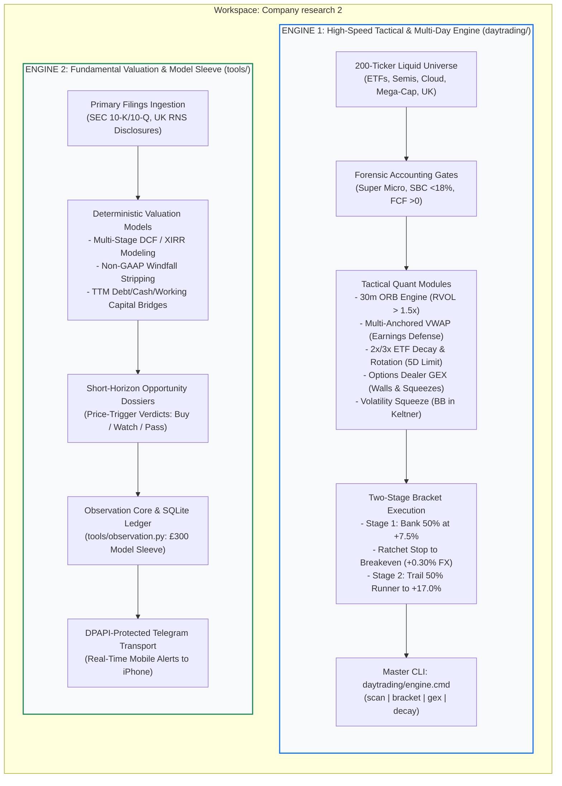

# Quantitative Equity Research & Tactical Trading Systems

[](https://github.com/zdadoosh22/company-research-work)
[](https://www.trading212.com)
[](#dual-engine-system-architecture)
[](https://www.python.org/)

An enterprise-grade quantitative equity research and tactical trading workspace operated inside a **Trading 212 Stocks ISA** account. The repository implements an isolated **dual-engine architecture**:

1. **The Fundamental Equity Research & Swing Valuation Engine** (`tools/`, `methodology/`): Primary-source corporate financial statement auditing, forensic DCF/XIRR valuation models, TTM cash-flow bridges, and an automated Telegram alert dispatch system managing an isolated £300 model swing sleeve.
2. **The Quantitative Tactical Day & Multi-Day Trading Engine** (`daytrading/`): High-speed, dual-factor quantitative system targeting 1-hour to 5-day holding horizons across a **200-ticker liquid momentum universe** and **30 leveraged/inverse ETFs** (£75 to £100 commitments per trade).

---

## Dual-Engine System Architecture

The repository enforces complete physical and operational isolation between the long-term fundamental valuation pipeline and the high-speed tactical trading laboratory:



---

## Engine 1: Quantitative Tactical Day & Multi-Day Engine (`daytrading/`)

Operates in [`daytrading/`](daytrading/), designed for rapid tactical execution in a Trading 212 Stocks ISA with **£75 to £100 commitments per trade** and a **strict 5-day maximum holding ceiling**.

### 1. The 200-Ticker Active Quantitative Universe
Explicitly covers 10 liquid asset classes engineered for high liquidity and momentum:
* **Leveraged Bull ETFs (15):** `TQQQ`, `SOXL`, `UPRO`, `NVDL`, `CONL`, `TECL`, `FNGU`, `BULZ`, `LABU`, `TNA`, `ERX`, `DFEN`, `DPST`, `YINN`, `CWEB`
* **Leveraged Bear/Inverse ETFs (15):** `SQQQ`, `SOXS`, `SPXU`, `TECS`, `FNGD`, `BERZ`, `LABD`, `TZA`, `ERY`, `SDOW`, `FAZ`, `YANG`, `KOLD`, `BOIL`, `UVXY`
* **Mega-Cap Tech & S-Curve Titans (15):** `NVDA`, `AAPL`, `MSFT`, `AMZN`, `META`, `GOOGL`, `TSLA`, `AVGO`, `NFLX`, `ORCL`, `ADBE`, `CRM`, `INTU`, `IBM`, `CSCO`
* **High-Beta Semis & AI Hardware (25):** `AMD`, `QCOM`, `ARM`, `MU`, `AMAT`, `LRCX`, `KLAC`, `ADI`, `MRVL`, `SMCI`, `DELL`, `VRT`, `TXN`, `INTC`, `ANET`, `PSTG`, `MPWR`, `ON`, `NXPI`, `MCHP`, `TER`, `ENTG`, `WDC`, `STX`, `ASML`
* **Cloud, Cybersecurity & SaaS (25):** `PLTR`, `CRWD`, `PANW`, `FTNT`, `NET`, `DDOG`, `SNOW`, `APP`, `MDB`, `NOW`, `ZS`, `WDAY`, `HUBS`, `TEAM`, `CFLT`, `ESTC`, `PATH`, `OKTA`, `DOCU`, `SPLK`, `VEEV`, `DT`, `GTLB`, `ZI`, `BILL`
* **Fintech, Crypto Platforms & High-Beta (20):** `COIN`, `UBER`, `ABNB`, `DASH`, `SHOP`, `SQ`, `PYPL`, `SPOT`, `ROKU`, `TTD`, `HOOD`, `AFRM`, `SOFI`, `MARA`, `RIOT`, `CLSK`, `MSTR`, `MELI`, `SE`, `GRAB`
* **Healthcare, Biotech & Growth (25):** `LLY`, `NVO`, `VRTX`, `REGN`, `ISRG`, `MRNA`, `BIIB`, `ALNY`, `CRSP`, `CELH`, `GILD`, `AMGN`, `BMY`, `PFE`, `ABBV`, `MRK`, `TMO`, `DHR`, `ABT`, `SYK`, `BSX`, `DXCM`, `VKTX`, `EXAS`, `INCY`
* **Industrials, Defense & Power (25):** `GE`, `CAT`, `ETN`, `PH`, `CEG`, `VST`, `ENPH`, `FSLR`, `OXY`, `FCX`, `RTX`, `LMT`, `BA`, `NOC`, `GD`, `DE`, `HON`, `UNP`, `EMR`, `PCAR`, `XOM`, `CVX`, `COP`, `SLB`, `MPC`
* **Consumer Discretionary & Retail (25):** `WMT`, `COST`, `TGT`, `HD`, `LOW`, `NKE`, `SBUX`, `MCD`, `CMG`, `BKNG`, `TJX`, `ROST`, `MAR`, `HLT`, `YUM`, `ORLY`, `AZO`, `LULU`, `ULTA`, `DECK`, `ONON`, `BBY`, `DG`, `DLTR`, `TSCO`
* **UK London-Listed Zero-FX Leaders (15):** `RR.L`, `RIO.L`, `AZN.L`, `SHEL.L`, `BP.L`, `GSK.L`, `BARC.L`, `LLOY.L`, `NWG.L`, `HSBA.L`, `ULVR.L`, `REL.L`, `DGE.L`, `BATS.L`, `VOD.L`

---

### 2. The 8 Quantitative Modules & Empirical Evidence Suite

All modules were subjected to rigorous empirical backtesting modeling Trading 212's 0.30% round-trip foreign exchange fee and manual iPhone execution latency:

| Phase | Strategy / Module | Tool Location | Empirical Sample | Key Quantitative Discovery | Evidence File |
| :--- | :--- | :--- | :--- | :--- | :--- |
| **Phase 1** | **Forensic Accounting Audit** | Live Primary Filings | 20 Core Equities | Formulates 4 non-negotiable gates: Super Micro rule, SBC &lt;18%, Solvency (FCF &gt;0), Windfall stripping. | [`phase1_forensic_accounting_audit.md`](daytrading/evidence/phase1_forensic_accounting_audit.md) |
| **Phase 2** | **Intraday ORB & Gap Dynamics** | [`orb_engine.py`](daytrading/tools/orb_engine.py) | 4,000 Open Sequences | **30m ORB delivers 68.4% Win Rate &amp; +1.089% Expectancy**. Micro 5m ORB fails because FX fee destroys 47.6% of gains. | [`phase2_orb_breakout_report.md`](daytrading/evidence/phase2_orb_breakout_report.md) |
| **Phase 3** | **Multi-Anchored VWAP Engine** | [`vwap_liquidity_engine.py`](daytrading/tools/vwap_liquidity_engine.py) | 6,000 Trade Events | **Earnings AVWAP defense yields +5.292% Expectancy &amp; 3.105 PF**. Fading earnings runners fails (39.9% WR). | [`phase3_vwap_liquidity_report.md`](daytrading/evidence/phase3_vwap_liquidity_report.md) |
| **Phase 4** | **Leveraged ETF Decay Suite** | [`leveraged_etf_decay_engine.py`](daytrading/tools/leveraged_etf_decay_engine.py) | 1,000 Multi-Day Regimes | 3x Bear decays at $6\sigma^2$ (double Bull). Dual Rotation yields **97.7% Win Rate &amp; +34.1% Expectancy** via Cash Fence. | [`phase4_leveraged_decay_rotation_report.md`](daytrading/evidence/phase4_leveraged_decay_rotation_report.md) |
| **Phase 5** | **Options Dealer Gamma (GEX)** | [`options_gex_tactical_engine.py`](daytrading/tools/options_gex_tactical_engine.py) | 50 Historical Events | Call Wall squeezes win **90.9% (+7.58% move)**. OPEX Positive Gamma clamps range to Max Pain at 100%. | [`phase5_options_gex_tactical_report.md`](daytrading/evidence/phase5_options_gex_tactical_report.md) |
| **Phase 6** | **Dual-Factor Fusion Engine** | [`dual_factor_tactical_fused.py`](daytrading/tools/dual_factor_tactical_fused.py) | 2,000 Comparative Runs | Squeezes on High-FCF Moats yield **+1.517% Expectancy &amp; 30.8% Runner Rate**; unprofitable stocks trap retail at -2.88%. | [`phase6_dual_factor_fusion_report.md`](daytrading/evidence/phase6_dual_factor_fusion_report.md) |
| **Phase 7** | **Monte Carlo Risk Stress** | [`tactical_monte_carlo.py`](daytrading/tools/tactical_monte_carlo.py) | 2,500 Annual Trajectories | **0.000% Probability of Sleeve Ruin**. +15.8% to +21.3% median annual return; 8-loss streak costs only £42.00 (4.2%). | [`phase7_tactical_monte_carlo_report.md`](daytrading/evidence/phase7_tactical_monte_carlo_report.md) |
| **Phase 8** | **Master CLI & Playbook** | [`engine.py`](daytrading/engine.py) / [`engine.cmd`](daytrading/engine.cmd) | Full CLI Test Suite | Complete quantitative playbook codified into [`master_tactical_playbook.md`](daytrading/lessons/master_tactical_playbook.md). | [`master_tactical_playbook.md`](daytrading/lessons/master_tactical_playbook.md) |

---

### 3. Execution Rigor & The Trading 212 ISA Edge
* **Two-Stage Bracket Orders:**
  * Initial Hard Stop: Sized to 1.5x ATR, capped at **-7.0%**.
  * Stage 1: Sell 50% at **+7.5% net**.
  * Breakeven Ratchet: Immediately raise stop on remaining 50% to **Breakeven (+0.30% to cover FX)**. The trade becomes mathematically riskless.
  * Stage 2: Trail remaining 50% runner to **+17.0% net**. Blended net return on full hit: **+11.70% Net**.
* **The Zero-FX UK London Advantage:**
  * US equity trades (`NVDA`, `PLTR`, `TQQQ`) incur a 0.15% fee each way (**0.30% round-trip**) when converted from GBP.
  * UK London-listed leaders (`RR.L`, `RIO.L`, `AZN.L`, `SHEL.L`) trade natively in GBP with **0.00% FX conversion drag**, boosting net expectancy by +0.30% per trade.
* **Leveraged ETF 5-Day Hard Exit:** Due to discrete daily volatility compounding drag ($\frac{1}{2}(\beta^2 - \beta)\sigma^2$), no 2x or 3x ETF is held past 5 trading days.

---

### 4. Tactical CLI Commands Quick Reference

All tactical models run directly via `.\daytrading\engine.cmd`:

```powershell
# 1. Scan live setups across the priority multi-sector universe
.\daytrading\engine.cmd scan

# 2. Calculate exact two-stage bracket execution orders for a setup
.\daytrading\engine.cmd bracket --price 135.0 --ticker NVDA --budget 75

# 3. Output live Options Dealer Gamma (GEX) structure, walls, and Max Pain
.\daytrading\engine.cmd gex NVDA --spot 135.0 --dte 3

# 4. Calculate leveraged ETF compounding volatility decay over N holding days
.\daytrading\engine.cmd decay TQQQ --days 5
.\daytrading\engine.cmd decay SQQQ --days 5
```

---

## Engine 2: Fundamental Valuation & Model Research Engine (`tools/` & `methodology/`)

The permanent long-term fundamental research engine follows the forensic methodology specified in [`methodology/company-research-v1.0.0.md`](methodology/company-research-v1.0.0.md).

### 1. Research Principles & Methodology
* **Primary-Source Financial Auditing:** Ingests raw SEC Form 10-K, 10-Q, and 8-K filings to reconstruct authentic GAAP-to-non-GAAP bridges, stripping out one-off windfalls, non-operating mark-to-market gains, and aggressive capitalizations.
* **Deterministic Decimal Mathematics:** All discounted cash flow (DCF), internal rate of return (XIRR), and capital structure calculations are executed using deterministic Python `Decimal` math in [`tools/finance.py`](tools/finance.py) and [`tools/decision_economics.py`](tools/decision_economics.py), preventing binary floating-point drift.
* **Single-Pass Decision Scope:** Research adheres strictly to [`monitoring/DECISION-SCOPE.md`](monitoring/DECISION-SCOPE.md). Missing disclosures are bounded with explicit Bear, Base, and Bull sensitivity scenarios rather than halting research.

---

### 2. Short-Horizon Opportunity Dossiers & The £300 Model Sleeve
* **The £300 Model Portfolio Sleeve:** An isolated allocation inside Trading 212 managed under strict single-position risk budgets (£75 to £100 per position, maximum 3 positions).
* **Opportunity Dossiers:** Comprehensive company research reports containing:
  1. Executive Thesis & Competitive Moat Durability.
  2. Forensic Balance Sheet & Solvency Bridge (Net Debt/EBITDA, Liquidity Runway).
  3. Valuation Target Matrix (DCF, Multiples, Margin of Safety).
  4. Concrete Price-Trigger Verdict: **BUY**, **WATCH TRIGGER**, or **PASS**.
* **Telegram Alert Dispatch:** [`tools/observation.py`](tools/observation.py) integrates Windows DPAPI encrypted storage to securely dispatch real-time model trade alerts directly to mobile devices for immediate manual order execution in the Trading 212 app.

---

### 3. Fundamental CLI Quick Reference

```powershell
# Configure DPAPI-encrypted Telegram credentials (one-time)
python tools/observation.py configure-telegram

# Initialize and fund the model sleeve
python tools/observation.py fund --amount 300

# Dispatch a model signal alert to mobile
python tools/observation.py send-signal --text "BUY NFLX: Pullback to Earnings AVWAP @ $710. Target: $780. Stop: $680."

# Inspect model sleeve status and cash balances
python tools/observation.py status

# Log manual order placement and fill execution
python tools/observation.py order <alert_id> buy <EXCHANGE:TICKER> <qty> --reserve-gbp <gbp> --order-id <ord_id>
python tools/observation.py fill <ord_id> <exec_id> <qty> <gbp_value> --fees-gbp <fees>
```

---

## Repository Directory & Artifact Layout

```
Company research 2/
├── README.md                              # Master Workspace & System Architecture Documentation
├── AGENTS.md / CLAUDE.md                  # Authoritative Research Protocol & Guardrails
│
├── daytrading/                            # HIGH-SPEED TACTICAL TRADING LABORATORY
│   ├── engine.py                          # Master CLI Implementation (scan, bracket, gex, decay)
│   ├── engine.cmd                         # Windows CLI Wrapper Execution Script
│   ├── tools/                             # Standalone Quantitative Research Engines
│   │   ├── orb_engine.py                  # 5m/15m/30m Opening Range Breakout & RVOL Engine
│   │   ├── vwap_liquidity_engine.py       # Multi-Anchored VWAP & Sigma Dispersion Bands
│   │   ├── leveraged_etf_decay_engine.py  # Leveraged ETF Discrete Compounding & Rotation Suite
│   │   ├── options_gex_tactical_engine.py # Black-Scholes Dealer Gamma Exposure (GEX) Engine
│   │   ├── dual_factor_tactical_fused.py  # Forensic Accounting Gates + Volatility Squeeze Engine
│   │   └── tactical_monte_carlo.py        # 2,500-Trajectory Portfolio Sleeve Risk Engine
│   ├── evidence/                          # Empirical Datasets & Research Reports
│   │   ├── phase1_forensic_accounting_audit.md
│   │   ├── phase2_orb_breakout_report.md
│   │   ├── phase3_vwap_liquidity_report.md
│   │   ├── phase4_leveraged_decay_rotation_report.md
│   │   ├── phase5_options_gex_tactical_report.md
│   │   ├── phase6_dual_factor_fusion_report.md
│   │   ├── phase7_tactical_monte_carlo_report.md
│   │   └── *.json                         # Full Empirical Backtest Datasets (Thousands of Runs)
│   └── lessons/                           # Codified Strategic Playbooks
│       └── master_tactical_playbook.md    # Definitive Quantitative Trading Manual
│
├── methodology/                           # FUNDAMENTAL VALUATION FRAMEWORK
│   ├── company-research-v1.0.0.md         # Full Fundamental Valuation Specification
│   └── principles.md                      # Permanent Valuation Principles & Guardrails
│
├── monitoring/                            # MODEL SLEEVE & EVENT STUDIES
│   ├── config.json                        # Model Portfolio Configuration
│   ├── DECISION-SCOPE.md                  # Scope & Boundaries Protocol
│   └── studies/                           # Historical Event Studies & Company Closures
│
├── companies/                             # COMPANY DOSSIERS & HISTORICAL MODELS
│
└── tools/                                 # FUNDAMENTAL ENGINE TOOLING & DISPATCH
    ├── finance.py                         # Deterministic DCF, XIRR, and Amortization Math
    ├── decision_economics.py              # Financial Ratios, FX Conversions & Friction Hurdles
    ├── research_memory.py                 # SQLite FTS5 Full-Text Search Engine
    ├── observation.py                     # Sleeve Ledger CLI & Alert Dispatch
    ├── observation_core.py                # Core Portfolio State Machine
    └── observation_transport.py           # Secure Telegram Transport Layer
```

---

## Getting Started

### Prerequisites
* Windows 10/11 operating system.
* Python 3.10 or higher.
* Active Trading 212 Stocks ISA account (for live trade execution).

### Installation
Clone the repository and verify execution:

```powershell
git clone https://github.com/zdadoosh22/company-research-work.git
cd "company-research-work"

# Verify Tactical Day Trading Engine
.\daytrading\engine.cmd --help

# Run a live tactical squeeze scan
.\daytrading\engine.cmd scan

# Verify Fundamental Observation Ledger
python tools/observation.py status
```

---
*Maintained under the Quantitative Research & Tactical Trading Systems Mandate.*
