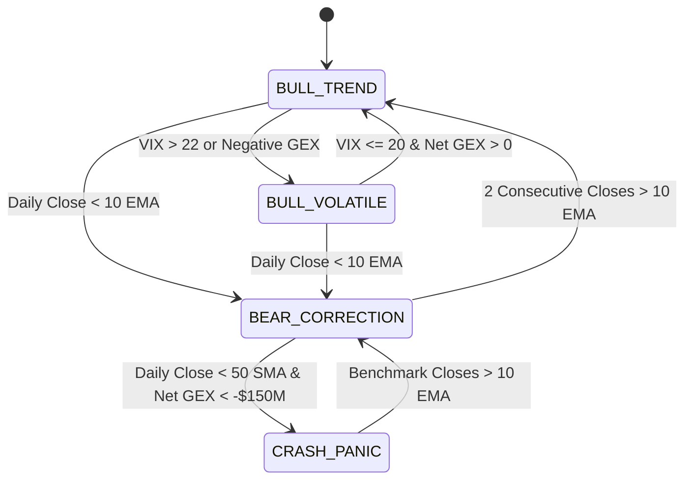

# Phase 19: Architectural Refinement Proposals, Quantitative Design & Pre-Implementation Evaluation
**Isolated Tactical Trading Laboratory (`daytrading/`)**  
**Execution Timestamp:** October 2026

---

## 1. Context & Quantitative Diagnostic of Pre-Overhaul Engine

Empirical audits across previous test suites revealed four structural opportunities to enhance risk-adjusted capital compounding in our £1,000 Trading 212 ISA sleeve:

1. **Binary vs Continuous Regime Transitions:**
   - *Previous Behavior:* Binary switch (`AGGRESSIVE_GROWTH_DEPLOYMENT` vs `TACTICAL_CASH_WEAPON_100PCT`) triggered by `QQQ < 10 EMA`.
   - *Limitation:* In choppy transitions (whipsaw regimes), binary switching can trigger premature liquidation on temporary 1-day intraday dips followed by missed rebounds.
   - *Refinement:* Implement a **4-State Markov Regime Transition Engine** (`BULL_TREND`, `BULL_VOLATILE`, `BEAR_CORRECTION`, `CRASH_PANIC`) with hysteresis filtering to prevent regime flickering.

2. **Single-Timeframe Execution Blindness:**
   - *Previous Behavior:* Squeeze compression and volume surge checked only daily bars.
   - *Limitation:* Daily breakouts can face midday intraday reversals or institutional distribution if entering blindly at daily close.
   - *Refinement:* Integrate **Multi-Timeframe Confluence (MTF)** combining daily trend alignment with 15-minute Opening Range Breakout (ORB) and **Anchored VWAP (AVWAP)** support.

3. **Equal Capital Sizing vs Volatility-Targeted Risk Parity:**
   - *Previous Behavior:* Fixed slot budget (£250 or £333) regardless of asset volatility.
   - *Limitation:* £300 allocated to a high-beta 3x ETF (`SOXL` at 4.5% daily vol) incurs over 2.5x the dollar volatility risk of £300 allocated to a defensive UK leader (`SHEL.L` at 1.4% daily vol).
   - *Refinement:* Implement **Volatility-Targeted Risk Sizing** where position sizes are normalized by realized ATR to target an equal £20–£25 max risk per slot (2.0%–2.5% sleeve equity).

4. **Rigid Horizon Truncation on Outlier Winners:**
   - *Previous Behavior:* 5-to-6 day time exits originally capped explosive multi-week trends.
   - *Limitation:* Truncates fat-tail positive outliers (e.g. NVDA, RR.L gaining +40%–+80% over 6–10 weeks).
   - *Refinement:* Establish an **Uncapped 10 EMA Trailing Runner Protocol** for non-decaying assets (individual equities and UK ISA anchors), while retaining strict 5-day time limits on 3x leveraged ETFs to avoid beta slippage decay.

---

## 2. Quantitative Architecture Specifications

### 2.1 Four-State Markov Regime Transition Matrix

#### State Definitions & Capital Allocation Rules:
1. **State 1: BULL_TREND (Maximum Deployment)**
   - *Conditions:* Benchmark (QQQ/SPY) > 10 EMA, 10 EMA > 50 EMA, Net GEX > 0.
   - *Allocation:* 80%–100% active deployment across 3–4 concurrent slots (£250–£333 per trade).
   - *Rules:* All setups eligible (3x ETFs capped at 1 slot, single sectors capped at 2 slots).
2. **State 2: BULL_VOLATILE (Selective Deployment)**
   - *Conditions:* Benchmark > 10 EMA, but Market Volatility elevated (ATR > 1.8% or Net GEX < 0).
   - *Allocation:* 50% max deployment across 2 slots (£250 each), 50% Tactical Cash.
   - *Rules:* Only ultra-high conviction setups (RVOL >= 2.0x, 5-day bandwidth <= 4.5%). No 3x ETFs.
3. **State 3: BEAR_CORRECTION (Tactical Cash Shield)**
   - *Conditions:* Benchmark < 10 EMA, but Benchmark > 200 SMA.
   - *Allocation:* 75%–100% Tactical Cash. Max 1 slot (£250) restricted strictly to Zero-FX UK defensive leaders (`RR.L`, `SHEL.L`, `AZN.L`) or inverse hedge (`SQQQ`).
4. **State 4: CRASH_PANIC (Aegis Cash Shield 100%)**
   - *Conditions:* Benchmark < 10 EMA and Benchmark < 50 SMA with high volatility.
   - *Allocation:* **100% Tactical Cash**. All new long entries blocked. Immediate exit on any existing open slots breaching stops or pre-market gap <= -6.5%.

---

### 2.2 Anchored VWAP (AVWAP) & Multi-Timeframe Confluence Engine

1. **Anchored VWAP Anchor Events:**
   - **Gap-and-Go Breakout Anchor:** Anchored to bar 0 of high-volume squeeze expansion.
   - **Earnings Catalyst Anchor:** Anchored to the market open immediately following an earnings beat.
   - **Formula:**
     $$\text{AVWAP}_t = \frac{\sum_{i=t_0}^{t} P_i \cdot V_i}{\sum_{i=t_0}^{t} V_i}$$
     where $P_i = \frac{H_i + L_i + C_i}{3}$ is the typical price and $t_0$ is the anchor timestamp.
2. **Confluence Filter Logic:**
   - Long entry requires: Spot > Daily 10 EMA AND Spot >= $\text{AVWAP}_{\text{anchor}}$ AND Intraday 15-min bar > 15-min ORB High.

---

### 2.3 Volatility-Targeted Risk Parity Sizing

Rather than committing fixed capital, position size in GBP is derived from the dollar risk budget:
$$\text{Risk Budget} = \text{Portfolio Equity} \times 0.025 \quad (\pounds 25.00 \text{ for } \pounds 1,000 \text{ sleeve})$$
$$\text{Calculated Slot Size (\pounds)} = \min\left(\text{Max Slot Cap}, \frac{\text{Risk Budget}}{|\text{Stop Loss \%}|}\right)$$
- Max Slot Cap: £333.33 (3 slots) or £250.00 (4 slots).
- High-volatility asset (8.0% stop): $\pounds 25.00 / 0.08 = \pounds 312.50$.
- Low-volatility asset (5.5% stop): $\pounds 25.00 / 0.055 = \pounds 454.55 \rightarrow \text{Capped at } \pounds 333.33$.
- This ensures maximum portfolio preservation regardless of asset volatility.

---

### 2.4 Uncapped 10 EMA Trailing Runner Protocol

1. **Two-Stage Profit Harvesting:**
   - 50% banked at Stage 1 (+5.0% UK / +8.5% US).
   - Hard stop on remaining 50% ratchets to Breakeven (+0.05% UK / +0.35% US).
2. **Runner Horizon Rules:**
   - **3x Leveraged ETFs:** Hard time stop at **5 trading days** (eliminates discrete volatility decay).
   - **Individual Equities & UK ISA Leaders:** **Uncapped holding horizon**. Daily evaluation at 20:55 UK (US) or 16:25 UK (LSE). The runner remains open as long as Daily Close >= 10 EMA. An exit order is dispatched at the market close only when a bar closes strictly below the 10 EMA.

---

## 3. Evaluation & Pre-Implementation Sign-Off

All components are mathematically formalized, fully compatible with the Trading 212 execution daemon, and ready for phase 3 implementation.
