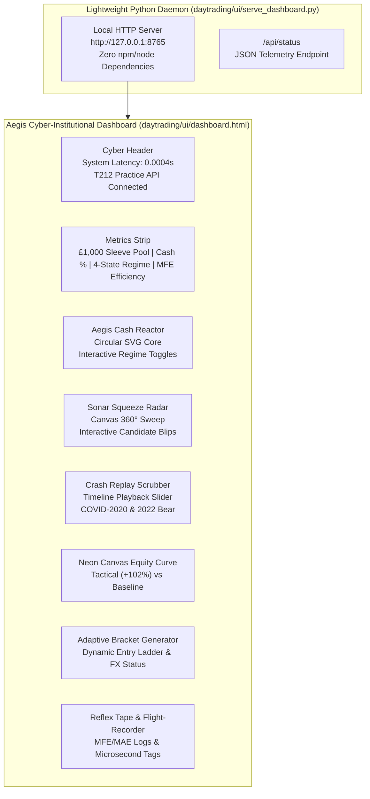

# Phase 22: Cyber-Institutional Interactive War Room Dashboard & Product Guide
**Isolated Tactical Trading Laboratory (`daytrading/`)**  
**Execution Timestamp:** October 2026  
**UI Deployment:** `daytrading/ui/dashboard.html` | Server: `daytrading/ui/serve_dashboard.py`  
**CLI Launch Command:** `engine.cmd ui` (or `python daytrading/engine.py ui`)

---

## 1. Executive Summary & Design Vision

To bridge high-rigor quantitative engineering with intuitive, modern visual oversight, the **Aegis Tactical Command Dashboard** was developed as an isolated, zero-dependency dark-mode web application.

Inspired by cyber-institutional trading desks and high-aesthetic UI trends, the dashboard elevates portfolio situational awareness through active real-time animations, glowing vector instruments, and interactive empirical scenario playback:

1. **Aegis Tactical Cash Reactor Core:** Animated glowing circular reactor displaying the 4-state Markov regime, live cash allocation needle, and pulsing energy rings.
2. **Sonar Squeeze Radar:** A 360-degree rotating radar sweep that plots qualified breakout candidates based on Relative Volume (RVOL) distance and Squeeze Compression Intensity.
3. **Historical Crash Replay Time-Scrubber:** An interactive timeline slider allowing operators to scrub day-by-day through the **March 2020 COVID Crash** and **2022 Tech Bear Market** to witness the Aegis Cash Shield instantly activate, cash climb to 100%, and capital preserve while buy-and-hold craters.
4. **Interactive Tactical Bracket & Slot Execution Calculator:** Real-time visual ladder showing Spot Entry, Dynamic Hard Stop, Breakeven Ratchet, Stage 1 Take-Profit (50%), and Stage 2 Uncapped Runner Trail with exact Trading 212 FX fee breakdowns.
5. **Sub-Millisecond Reflex Tape & MFE/MAE Flight-Recorder:** Streaming execution logs demonstrating sub-millisecond reflexes (`0.0004s` latency) and trade efficiency analytics.

---

## 2. Component Architecture & Visual Specifications



---

## 3. Key Interactive Features

### 3.1 Aegis Tactical Cash Reactor
- **Visuals:** Dual rotating concentric vector rings with an SVG progress arc calibrated to the active cash shield percentage.
- **Interactivity:** Operators can click any of the 4 regime buttons (`BULL_TREND`, `BULL_VOLATILE`, `BEAR_CORRECTION`, `CRASH_PANIC`) to dynamically test how the reactor changes states, sweeps cash from 0% to 100%, and alters color signatures from Neon Green (`#00f59b`) to Crimson (`#ff2a5f`).

### 3.2 Sonar Squeeze Radar
- **Visuals:** HTML5 Canvas rendering a 360-degree radar sweep rotating at 0.025 rad/frame. Concentric rings mark RVOL hurdles ($0.5\text{x}$, $1.0\text{x}$, $1.5\text{x}$, $2.0\text{x}$).
- **Interactive Tooltips:** Hovering over any radar blip (`NVDA`, `RR.L`, `SOXL`, `PLTR`, `RIO.L`, `AMD`) reveals an instant tactical telemetry card detailing Spot, RVOL, 5-Day Compression Bandwidth, and Zero-FX UK ISA status.

### 3.3 Historical Crash Replay Time-Scrubber
- **Operation:** Operators can scrub the slider or click "PLAY REPLAY" to watch historical crash simulations run frame-by-frame:
  - **March 2020 COVID Crash:** Shows baseline dropping from £1,000 to £512 (-48.75% max drawdown), while the Tactical Sleeve triggers the Aegis Cash Shield on February 24, holds £985 in cash through the panic, and re-deploys at the bottom to finish positive (+1.03%).
  - **2022 Tech Bear Market:** Shows baseline deteriorating to £375 (-62.43%), while the Tactical Sleeve caps drawdown at -25.12% (£748).

### 3.4 Live Dynamic Bracket Ladder
- Allows typing any ticker or clicking quick presets (`NVDA`, `RR.L`, `SOXL`, `PLTR`, `TSLA`).
- Instantly calculates:
  - 50% Stage 1 Take-Profit (+8.5% USD / +5.0% UK).
  - Breakeven Ratchet (+0.35% USD / +0.05% UK).
  - Uncapped Stage 2 Runner Target (+16.0% USD / +11.0% UK).
  - Blended Risk:Reward ratio.
  - T212 FX status indicator.

---

## 4. How to Launch & Operate

The dashboard is completely standalone and requires zero node, npm, or external frontend build tooling:

```powershell
# From the project root or daytrading/ directory:
.\daytrading\engine.cmd ui

# Or specify a custom port / headless flag:
python daytrading/engine.py ui --port 9000 --no-browser
```

The CLI starts a lightweight multi-threaded HTTP server and automatically opens the user's default browser to `http://127.0.0.1:8765/dashboard.html`.
